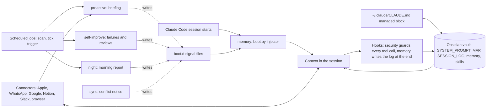

# Carlo Brain

[](https://github.com/Natanlsr3/carlo-brain/actions/workflows/tests.yml)


**A Jarvis for Claude Code: a second brain made of Markdown notes you own. It remembers your projects between sessions, opens each day with a short briefing, and never sends anything without your "go".**


Works with Claude Code (the most complete), OpenAI Codex CLI, Google Gemini CLI and any other LLM. Open source, no server, no account. Français : [démarrage rapide](docs/FR-demarrage.md).

```bash
git clone https://github.com/Natanlsr3/carlo-brain && cd carlo-brain
./install.sh      # asks 3 questions, then tells you which file to fill in
claude            # after you fill in MAP.md (5 minutes)
```

**Start here:** [Your first 10 minutes](#your-first-10-minutes) | [Everything it can do (one page)](docs/00-features.md) | [Install guide](docs/02-install.md)

**Contents**

- [Quickstart](#quickstart) and [Your first 10 minutes](#your-first-10-minutes)
- [What it is](#what-it-is), [Why not just CLAUDE.md?](#why-not-just-claudemd-or-a-memory-plugin) and [A day with it](#a-day-with-it)
- [What you get, by module](#what-you-get-by-module)
- [Use it with Codex, Gemini or any LLM](#use-it-with-codex-gemini-or-any-llm)
- [Privacy and risks](#privacy-and-risks)
- [Documentation](#documentation), [Words used here](#words-used-here) and [Command line](#command-line)
- [How it fits together](#how-it-fits-together), [Status](#status), [Contributing](#contributing), [License](#license)

## Quickstart

```bash
git clone https://github.com/Natanlsr3/carlo-brain && cd carlo-brain
./install.sh                                          # asks for a vault folder, a name for your assistant, your first name
carlo add agents-skills search review-loop health     # optional modules that work with no setup, any time
```

Prerequisites: macOS or Linux, Python 3.9+, git, and [Claude Code](https://docs.claude.com/en/docs/claude-code) installed and logged in. If the installer says `carlo` is not on your PATH, run the one line it prints and open a new terminal.

Two modules need a source connected first, or they have nothing to show: **`proactive`** (the morning briefing) needs WhatsApp, Apple Mail or a todo export, and **`connectors`** (Apple apps, WhatsApp, Google, Notion, Slack) needs the login or bridge of each one. Set the source up, then `carlo add proactive connectors`. Step by step: [docs/03-connect-your-sources.md](docs/03-connect-your-sources.md).

Then run `carlo doctor` to check the installation. The last line of the installer already says what to do next: fill in your map. Prerequisites and a step-by-step guide: [docs/02-install.md](docs/02-install.md).

## Your first 10 minutes

**1. Fill in your map (5 minutes).** Open `<vault>/00_System/MAP.md` (the default vault is `~/carlo-vault`) in Obsidian or any editor. This short file is read at every session start. Without it the first boot is empty. Say who you are, your three main projects, and where their files are. For example:

```markdown
**Who**: Sam, product designer in Lyon. Likes short answers, works in the evening.
**Active projects** (read the entry file BEFORE working on a project):
- Website redesign: new pricing page, checkout tests still red. Entry file: `10_Projects/website/website.md`.
- Freelance clients: two invoices to chase. Entry file: `10_Projects/clients/clients.md`.
- Spanish course: 20 minutes a day. Entry file: `10_Projects/spanish/spanish.md`.
**Where to look for more**: todo in Apple Reminders, contacts in the Contacts app.
```

The entry files can be three lines each. Create them as you go.

**2. Start `claude` and read the first message.** Run `claude` in any terminal. The assistant opens with a one-sentence "Ready" that recalls what it knows (your map, recent sessions, anything that needs attention). On day one it has no history yet, so the message is short. Nothing there? Run `carlo doctor`, then see the [FAQ](docs/09-faq.md#nothing-appears-at-session-start).

**3. Try three things.**

- Do one small task, quit (`/exit`), start `claude` again and type: `What did we do last session?` The answer comes from `SESSION_LOG.md`.
- Correct it once, for example: `Answer in two lines maximum from now on. Remember this.` It shows you the change as a diff, you say `yes`, and a new entry appears in `<vault>/00_System/CORRECTIONS.md`.
- In a terminal: `carlo search "pricing"` (use a word from your map). It lists `path:line: snippet` from your vault and folders. It needs the `search` module from the quickstart.

**4. Add the next module, knowing what it needs first.**

- `agents-skills`, `search`, `review-loop`, `health`: nothing. Just `carlo add`.
- `sync`: git. A private remote is optional ([module README](modules/sync/README.md)).
- `proactive`: a source connected first (WhatsApp bridge, Apple Mail with Full Disk Access, or a todo export), then enable it in `~/.carlo-brain/config.d/proactive.json`. Without one the briefing stays empty. [docs/03](docs/03-connect-your-sources.md).
- `connectors`: pick one connector and follow its guide. Each has its own login.
- `self-improve` and `night`: a long-lived login for unattended jobs (`create_token.sh`), and a dry run first. Read the Known limits in their READMEs.
- `other-agents`: Codex CLI or Gemini CLI installed, then `carlo connect codex` or `carlo connect gemini`.

The full list of features, with how to trigger each one, is on [one page](docs/00-features.md).

## What it is

Claude Code starts every session blind. Carlo Brain gives it the rest of an assistant, the way a Chief of Staff or a Jarvis would work. It uses **hooks** (small scripts that Claude Code runs at fixed moments, such as session start and end) and, for work between sessions, **scheduled jobs** (macOS launchd, the built-in scheduler; a cron line on Linux).

- **A memory map, loaded lazily.** Your notes live in a structured Obsidian vault (a folder of Markdown files). At boot the assistant gets only a short map (who you are, which projects, where each entry file is) and the last few sessions, capped at 9,000 characters. Everything else is read on demand, by branch: the project file the map names, a skill, the archive.
- **Specialist subagents with ready prompts.** A researcher, a reviewer, a cto, a reader, and more, each a Markdown file with its own role, tools and rules. The main assistant delegates instead of filling its own context.
- **Agents that watch and improve.** A proactive layer reads your mail, chats and todo and opens the day with a ranked briefing. Weekly jobs audit your own setup and propose changes; code, not the model, decides what gets applied.
- **Connectors.** Apple apps, WhatsApp, Google, Notion, Slack, a browser (Claude in Chrome, or Playwright through MCP, a standard way to plug tools into an AI assistant), web research, your phone, and OpenRouter if you want to send a task to a model other than Claude.
- **Safeguards.** Nothing is sent without your "go". Secrets are never opened. Every send is audited.

**Stable:** core, memory, security and sync. **Beta:** everything else (proactive, connectors, self-improve, night, agents-skills, review-loop, health, search, other-agents).

No server, no database, no SaaS: Python standard library and plain files. You pick the modules you want and remove them with one command.

## Why not just CLAUDE.md, or a memory plugin?

A `CLAUDE.md` is one file you maintain by hand. It works, and Carlo Brain uses one too (a short managed block that imports your map). It does not remember yesterday, does not watch anything, and grows until it is slow and half stale.

A memory plugin such as claude-mem remembers context: it captures what happened in your sessions and brings relevant pieces back. If that is all you need, use one. Carlo Brain does not claim to remember better than a dedicated plugin, and it has no semantic or vector search.

Carlo Brain is a whole assistant system around the memory:

- a **structured memory map with lazy loading** that you can read, edit and version, instead of an index you do not see;
- **specialised subagents** with prompts ready to go;
- **review agents and proactive agents**, and a weekly self-improvement loop with backup and undo;
- **connectors** to the places your information actually lives;
- **safeguards on sends** (draft, then "go"; secrets blocked; audit trail).

All of it is Markdown and small Python scripts in a folder you own. The two are not exclusive: nothing stops you running a memory plugin next to it.

## A day with it

**Morning.** You open a terminal and type `claude`. Before you say anything, the assistant knows what you did yesterday (it reads the last session log entries), what is waiting on you (a reply you owe, a schedule that arrived by mail and never reached your calendar), and whether anything broke overnight. It opens with five points, under 200 words, and ends with one question:

```text
Ready. Yesterday you were on the pricing page, tests still red on checkout.

1. Sam replied about the invoice. Draft ready.
2. You asked Alex for the contract 4 days ago. No answer. Nudge drafted.
3. Thursday 15:00 slot agreed in the team chat, not in your calendar.
4. Overnight: the weekly research digest finished (3 of 3 steps).
5. 2 facts from last session wait for your yes or no.

Send the reply to Sam? (go / let me look)
```

**Drafts, then "go".** The assistant never sends on its own. It prepares the text, shows it, and waits. You type `go` and exactly that text is sent. Edit one word and it comes back to you. With the `security` module a send that contains an API key, a card number or a password is blocked before it leaves.

**Memory across sessions.** Every session ends with an entry in `SESSION_LOG.md`: what was done, what was decided, what is next. If the assistant forgets to write one, a hook writes a minimal entry for it. Corrections you give ("never use a table in the terminal") go to `CORRECTIONS.md` and into the rules. After a context compaction, a hook points the assistant to a summary saved just before.

**It improves itself, with a seat belt.** Every week one job scouts the outside world (forums, docs, release notes) and another audits your own setup. They only propose. Code, not the model, decides what happens: a safe change to a skill is applied with a backup and checks, a change to your system prompt becomes a diff for you to read, a change to anything near secrets is refused. Everything applied can be undone with one command.

**Night work.** Put a multi-step task in a queue. When it is dark, you are home and the laptop is plugged in, the assistant works through it one step at a time, with every send tool denied. Next morning your session opens with one line per task: done, to finish (and at which step), or not started (and why).

## What you get, by module

Install what you want. The core is always installed. `memory` and `security` are on by default.

| Module | What it does | Status |
|---|---|---|
| **core** | System prompt, a short MAP of who you are and what you work on, session log, corrections log, starter skills, all as an Obsidian vault. A managed block in `~/.claude/CLAUDE.md` loads it every session. | tested |
| **memory** | Boot context injected at session start (hard cap 9,000 characters), automatic log entry, compaction summary, queue of facts to validate, mechanical session quality score, health line. | tested |
| **security** | Blocks reads of shell profiles, `.env` files and key files. Blocks sends that contain secrets. Hash-chained audit log of every send. Loop and alignment guardrails. A seat belt, not a sandbox. | tested |
| **sync** | Commits your vault at session start and end, optional private remote, optional server copy. Never force-pushes. | tested |
| **proactive** | Watches WhatsApp, Apple Mail, a todo export and follow-ups. Ranked briefing without any model call. Optional voice. | beta |
| **connectors** | Apple apps (read-only), WhatsApp, Google, Notion, Slack, browser (Playwright MCP), OpenRouter routing to other models, web research, phone control (Remote Control or Telegram), personal server, self-hosted vault MCP. | beta |
| **self-improve** | Weekly scout and improver jobs, tiered auto/review/manual apply with backup and restore, undo, personal bench, scheduler with catch-up. | beta |
| **night** | Queue of multi-step tasks, optional marathon, STATUS line judging, morning report. | beta |
| **agents-skills** | Agents `researcher`, `reviewer`, `cto`, `reader`, `listener`, `improver`, `video-quiz` and skills `writer`, `docs`, `explainer`, `browse`, installed without overwriting yours. | beta |
| **review-loop** | After a session changes code, asks the assistant to run the `reviewer` agent before saying done. Once per diff, no loops. | beta |
| **other-agents** | `carlo connect codex` / `carlo connect gemini` wire the same rules, boot context, guards and agents into OpenAI Codex CLI or Google Gemini CLI (each removable); `carlo context --copy` makes a paste-ready prompt for any other LLM. | beta |
| **health** | Watchdog for scheduled jobs and connectors: tells your next session what broke, relaunches a missed job once, and repairs known failures (`carlo health repair`). | beta |
| **search** | `carlo search`: read-only search across the vault, your folders (text, PDF, Word, PowerPoint, Excel), Notes, Messages and Mail (bodies included), with a deny list for secrets. | beta |

Platform: macOS and Linux. Python 3.9 or newer, standard library only. On Linux, modules that use launchd print a cron line instead, and the Apple readers are not available.

Per-feature details and how to trigger each one: [docs/00-features.md](docs/00-features.md).

## Use it with Codex, Gemini or any LLM

```bash
carlo connect codex      # or: carlo connect gemini   (add --mcp for Playwright, --remove to undo, --status to check)
carlo context --copy     # any other LLM: copies one paste-ready prompt (system prompt, map, recent sessions)
carlo doctor             # shows which tools are connected
```

What works, tool by tool. Codex: boot context yes (a hook, which you must trust once with `/hooks`), guards yes (secret reads and sends, shell and patches), agents as skills, MCP for Playwright. Gemini: boot context yes (a hook), guards yes (secret reads and shell sends; MCP sends are not guarded), agents as `/carlo:<name>` commands, MCP for Playwright. Any other LLM: the pasted prompt only, so memory at the start of the chat, with no hooks, no guards and no writing back unless that tool can write files. Claude Code stays the most complete (more hooks, subagents, scheduled jobs). Details: [modules/other-agents](modules/other-agents/README.md).

## Privacy and risks

Short version; the full one is [docs/07-security-and-privacy.md](docs/07-security-and-privacy.md).

- **What it reads.** Your vault, and with the modules you switch on: Apple Mail and WhatsApp databases (read only), your todo export, Apple apps. The briefing is built locally without a model call.
- **Everything stays local.** No server, no telemetry, no account. What leaves your machine is what Claude Code sends to Anthropic in your sessions, plus whatever connector you enable (Google, Notion, Slack, a hosted browser, OpenRouter, a Telegram bot).
- **Nothing is sent without "go".** The assistant drafts and shows the text. A send that contains a key, token, password, IBAN or card number is blocked.
- **The briefing is visible to Claude.** Once it is injected at session start, Claude sees names and short excerpts of your messages and mail, in that session.
- **Prompt injection is not solved.** A web page, mail or chat can contain text aimed at the assistant. The guards reduce the damage; they do not recognise every attack. It is a seat belt, not a sandbox.
- **Unattended jobs.** Night tasks, the weekly self-improve jobs and the Telegram bridge run without you, with every send tool denied. They can still write files: night tasks write drafts and reports; self-improve may edit your vault `memory/` and `skills/` folders, your agents and skills, and JSON config (with backup and checks), and a change to your system prompt or settings waits as a diff for you; anything near secrets is refused. The Telegram bridge is read only by default.

## Documentation

0. [Everything Carlo Brain can do](docs/00-features.md)
1. [What it is and why](docs/01-what-and-why.md)
2. [Install](docs/02-install.md)
3. [Connect your sources](docs/03-connect-your-sources.md)
4. [Extend it: skills, agents, hooks, jobs, modules](docs/04-extend.md)
5. [Architecture: how everything branches together](docs/05-architecture.md)
6. [Day to day: the rituals](docs/06-day-to-day.md)
7. [Security and privacy](docs/07-security-and-privacy.md)
8. [Costs and limits](docs/08-costs-and-limits.md)
9. [FAQ](docs/09-faq.md)
10. [What exists today, and what is missing](docs/10-what-exists-today.md)

Français : [démarrage rapide](docs/FR-demarrage.md).

Each module also has its own README in `modules/<name>/README.md`.

## Words used here

- **Hook**: a small script Claude Code runs at a fixed moment (session start, before a tool call, session end).
- **Vault**: your folder of Markdown notes, opened comfortably in Obsidian.
- **launchd**: the macOS built-in scheduler for jobs that run while you do not. On Linux a cron line replaces it.
- **MCP** (Model Context Protocol): a standard way to plug a tool, such as a browser, into an AI assistant.
- **`boot.d`**: a folder where any module leaves a note for the next session (`~/.carlo-brain/state/boot.d/`).
- **Subagent**: a specialist the main assistant hands a job to, defined by one Markdown file.

## Command line

```text
carlo init [--vault DIR] [--name NAME] [--user NAME] [--modules a,b|none] [--yes] [--force]
carlo add <module>... [--force]        carlo remove <module>... [--force]
carlo list                             carlo status
carlo doctor                           carlo config get|set <dotted.key> [json value]
carlo route status                     carlo route sync [--undo]
carlo connect browser|codex|gemini [--remove|--status]
carlo context [--copy] [--boot] [--refresh] [--max N]
carlo uninstall [--purge]
```

## How it fits together



The one convention that makes it modular: any module can add a section to the next session by dropping a Markdown file in `~/.carlo-brain/state/boot.d/`. The boot injector merges them, caps the total, and never fails the session. Details: [docs/05-architecture.md](docs/05-architecture.md). What each module does today and what is still missing: [docs/10-what-exists-today.md](docs/10-what-exists-today.md).

## Status

Version 0.1, beta. The test suite (pytest, also runnable with `python tests/run_all.py`) runs on macOS and Ubuntu with Python 3.9 and 3.12. What "beta" means here, module by module:

- **core, memory, security, sync**: logic and installer tested end to end in a temporary HOME. Hooks are the part that touches your real Claude Code settings, so install and uninstall take a timestamped backup and only remove entries they tagged.
- **proactive**: tested on simulated databases. The Apple Mail and WhatsApp readers depend on private file layouts that can change.
- **connectors**: guides for Anthropic connectors; code for Apple, Telegram, vault MCP tested on simulated sources and fake servers, never on real personal data. The server setup script is tested in dry-run only.
- **self-improve** and **night**: tested with a fake `claude`. No model is called in tests. Read the Known limits section of each README before leaving them unattended.
- **agents-skills**: installer and file formats tested; the quality of the answers is yours to judge, which is what the self-improve bench is for.

## Contributing

Issues and pull requests are welcome. The ground rules:

- Python 3.9+, standard library only unless a module declares a dependency in `module.toml`.
- A module is a folder with `module.toml`, `README.md`, `install.sh`, `uninstall.sh`, `src/` and `tests/`. See [docs/04-extend.md](docs/04-extend.md).
- No personal data, no keys, no paths of a real home directory in code, tests or docs. Tests use a temporary HOME and fake tools.
- Run `python -m pytest -q` before you push. New behaviour comes with a test.
- The tests scan for personal data. To make them reject extra terms of your own (your name, your company), set `CARLO_BRAIN_BANNED` to a comma separated list before running them.
- A module README states what it does, why, setup, how to customize, and its limits, including what is beta.

## License

MIT, see [LICENSE](LICENSE). Your vault, your keys and your data stay on your machine and are never part of this repository.
