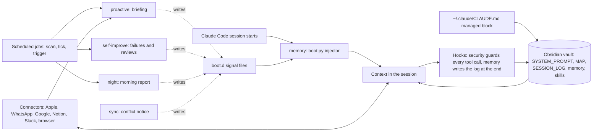

# Carlo Brain

[](https://github.com/Natanlsr3/carlo-brain/actions/workflows/tests.yml)


**A Jarvis for Claude Code: a personal agentic system with a structured memory, specialist subagents with ready-made prompts, agents that review and improve it, and connectors to your tools. All in Markdown you own.**


**Stable:** core, memory, security and sync. **Beta:** everything else (proactive, connectors, self-improve, night, agents-skills, review-loop, health, search).

Claude Code starts every session blind. Carlo Brain gives it the rest of an assistant, the way a Chief of Staff or a Jarvis would work:

- **A memory map, loaded lazily.** Your notes live in a structured Obsidian vault. At boot the assistant gets only a short map (who you are, which projects, where each entry file is) and the last few sessions, capped at 9,000 characters. Everything else is read on demand, by branch: the project file the map names, a skill, the archive.
- **Specialist subagents with ready prompts.** A researcher, a reviewer, a cto, a reader, and more, each a Markdown file with its own role, tools and rules. The main assistant delegates instead of filling its own context.
- **Agents that watch and improve.** A proactive layer reads your mail, chats and todo and opens the day with a ranked briefing. Weekly jobs audit your own setup and propose changes; code, not the model, decides what gets applied.
- **Connectors.** Apple apps, WhatsApp, Google, Notion, Slack, a browser (Claude in Chrome or Playwright), web research, your phone, and OpenRouter if you want to send a task to a model other than Claude.
- **Safeguards.** Nothing is sent without your "go". Secrets are never opened. Every send is audited.

No server, no database, no SaaS: Python standard library and plain files. You pick the modules you want and remove them with one command.

## Why not just CLAUDE.md, or a memory plugin?

A `CLAUDE.md` is one file you maintain by hand. It works, and Carlo Brain uses one too (a short managed block that imports your map). It does not remember yesterday, does not watch anything, and grows until it is slow and half stale.

A memory plugin such as claude-mem remembers context: it captures what happened in your sessions and brings relevant pieces back. If that is all you need, use one. Carlo Brain does not claim to remember better than a dedicated plugin, and it has no semantic or vector search.

Carlo Brain is a whole assistant system around the memory:

- a **structured memory map with lazy loading** that you can read, edit and version, instead of an index you do not see;
- **specialised subagents** with prompts ready to go;
- **review agents and proactive agents**, and a weekly self-improvement loop with backup and undo;
- **connectors** to the places your information actually lives;
- **safeguards on sends** (draft, then "go"; secrets blocked; audit trail).

All of it is Markdown and small Python scripts in a folder you own. The two are not exclusive: nothing stops you running a memory plugin next to it.

## A day with it

**Morning.** You open a terminal and type `claude`. Before you say anything, the assistant knows what you did yesterday (it reads the last session log entries), what is waiting on you (a reply you owe, a schedule that arrived by mail and never reached your calendar), and whether anything broke overnight. It opens with five points, under 200 words, and ends with one question:

```text
Ready. Yesterday you were on the pricing page, tests still red on checkout.

1. Sam replied about the invoice. Draft ready.
2. You asked Alex for the contract 4 days ago. No answer. Nudge drafted.
3. Thursday 15:00 slot agreed in the team chat, not in your calendar.
4. Overnight: the weekly research digest finished (3 of 3 steps).
5. 2 facts from last session wait for your yes or no.

Send the reply to Sam? (go / let me look)
```

**Drafts, then "go".** The assistant never sends on its own. It prepares the text, shows it, and waits. You type `go` and exactly that text is sent. Edit one word and it comes back to you. With the `security` module a send that contains an API key, a card number or a password is blocked before it leaves.

**Memory across sessions.** Every session ends with an entry in `SESSION_LOG.md`: what was done, what was decided, what is next. If the assistant forgets to write one, a hook writes a minimal entry for it. Corrections you give ("never use a table in the terminal") go to `CORRECTIONS.md` and into the rules. After a context compaction, a hook points the assistant to a summary saved just before.

**It improves itself, with a seat belt.** Every week one job scouts the outside world (forums, docs, release notes) and another audits your own setup. They only propose. Code, not the model, decides what happens: a safe change to a skill is applied with a backup and checks, a change to your system prompt becomes a diff for you to read, a change to anything near secrets is refused. Everything applied can be undone with one command.

**Night work.** Put a multi-step task in a queue. When it is dark, you are home and the laptop is plugged in, the assistant works through it one step at a time, with every send tool denied. Next morning your session opens with one line per task: done, to finish (and at which step), or not started (and why).

## What you get, by module

Install what you want. The core is always installed. `memory` and `security` are on by default.

| Module | What it does | Status |
|---|---|---|
| **core** | System prompt, a short MAP of who you are and what you work on, session log, corrections log, starter skills, all as an Obsidian vault. A managed block in `~/.claude/CLAUDE.md` loads it every session. | tested |
| **memory** | Boot context injected at session start (hard cap 9,000 characters), automatic log entry, compaction summary, queue of facts to validate, mechanical session quality score, health line. | tested |
| **security** | Blocks reads of shell profiles, `.env` files and key files. Blocks sends that contain secrets. Hash-chained audit log of every send. Loop and alignment guardrails. A seat belt, not a sandbox. | tested |
| **sync** | Commits your vault at session start and end, optional private remote, optional server copy. Never force-pushes. | tested |
| **proactive** | Watches WhatsApp, Apple Mail, a todo export and follow-ups. Ranked briefing without any model call. Optional voice. | beta |
| **connectors** | Apple apps (read-only), WhatsApp, Google, Notion, Slack, browser (Playwright MCP), OpenRouter routing to other models, web research, phone control (Remote Control or Telegram), personal server, self-hosted vault MCP. | beta |
| **self-improve** | Weekly scout and improver jobs, tiered auto/review/manual apply with backup and restore, undo, personal bench, scheduler with catch-up. | beta |
| **night** | Queue of multi-step tasks, optional marathon, STATUS line judging, morning report. | beta |
| **agents-skills** | Agents `researcher`, `reviewer`, `cto`, `reader`, `listener`, `improver`, `video-quiz` and skills `writer`, `docs`, `explainer`, `browse`, installed without overwriting yours. | beta |
| **review-loop** | After a session changes code, asks the assistant to run the `reviewer` agent before saying done. Once per diff, no loops. | beta |
| **health** | Watchdog for scheduled jobs and connectors: tells your next session what broke, relaunches a missed job once, and repairs known failures (`carlo health repair`). | beta |
| **search** | `carlo search`: read-only search across the vault, your folders (text, PDF, Word, PowerPoint, Excel), Notes, Messages and Mail (bodies included), with a deny list for secrets. | beta |

Platform: macOS and Linux. Python 3.9 or newer, standard library only. On Linux, modules that use launchd print a cron line instead, and the Apple readers are not available.

## What exists today, and what is missing

Checked against the code of this repository.

**Exists**
- **Agents** (`modules/agents-skills/src/agents`): `researcher`, `reviewer`, `cto`, `reader`, `listener`, `improver`, `video-quiz`. Skills: `writer`, `docs`, `explainer`. Installed without overwriting yours. Beta: the files and installer are tested, the quality of the answers is yours to judge.
- **Memory map and lazy loading** (`core` and `memory`): `MAP.md` and `SYSTEM_PROMPT.md` imported at start, a boot hook capped at 9,000 characters, a `boot.d` folder where any module leaves a note for the next session, everything else read on demand. Stable.
- **Review**: the `reviewer` agent (read only, ranks findings by severity) for finished work; the `improver` agent and weekly job for your own setup; the `review` tier of self-improve, which turns risky changes into a diff for you to read.
- **Proactive**: the `proactive` module (WhatsApp, Apple Mail, todo, follow-ups, briefing without a model call), the `listener` agent, and the weekly `self-improve` scout and improver jobs. `carlo doctor` and a health line at boot report broken hooks and sources. Beta.
- **Browser** (`connectors/browser`, beta): `carlo connect browser` registers the Playwright MCP server (idempotent, removable, version can be pinned), `carlo doctor` checks it, and the `browse` skill enforces the rules (own tab, no form, payment or login without your go). Claude in Chrome and hosted automation stay guides.
- **Routing to other models** (`connectors/openrouter`, beta): a script for any OpenAI-compatible endpoint, plus `route.py`, which sends a task to the model configured for an agent or a task kind (`config.d/routing.json`) and falls back to Claude on error. `carlo route sync` applies that file inside Claude Code: an entry like `"researcher": "claude:haiku"` sets the `model:` field of the installed agent (backup of the original, `--undo` restores), and `"researcher": "openrouter:<model>"` generates a `researcher-routed` wrapper agent (Bash only, calls `route.py` with the role prompt) plus a small skill telling the assistant to prefer it for the routed task kinds. `carlo route status` and `carlo doctor` show drift. Tested with HTTP and `claude` mocked. Limits: Claude Code still cannot swap a model by itself, so a non-Claude model is used only when the assistant chooses the `-routed` agent (the skill nudges it, nothing forces it); a wrapper returns text only, with none of the original agent's tools; `CLAUDE_CODE_SUBAGENT_MODEL` or a per-call model overrides the `model:` field; after a sync, `agents-skills` treats the edited agent file as yours (it keeps it and saves its version as `.new`), so re-run `carlo route sync` after changing agents.
- **Review loop** (`review-loop`, beta): an opt-in `Stop` hook that asks the assistant to run the `reviewer` agent when a session changed code, once per diff and capped per session, switchable with `carlo config`.
- **Watchdog and self-repair** (`health`, beta): checks that scheduled jobs ran within their interval and that connectors still work (login token file, WhatsApp and Apple databases, Telegram token, expected MCP servers). Your next session hears about it only when something is broken; a missed job is relaunched once; `carlo doctor` shows the same status. A repair playbook fixes the safe cases on its own, once per failure per 24 hours, each logged: an unloaded launchd job, a vanished MCP server (command stored in config), a dead WhatsApp bridge, an oversized log, a missing state folder. An expired login, a lost Full Disk Access or a missing key are never touched: the exact one-line command reaches your next session. `carlo health status`, `carlo health repair [--dry-run]`, off switch in config.
- **Search over your computer** (`search`, beta): `carlo search "words"` is read-only and looks in the vault, your folders, Apple Notes, Messages and Mail (Spotlight optional). It reads inside PDF (`pdftotext`, else macOS `mdimport`/Spotlight text), `.docx`, `.pptx`, `.xlsx` and Apple Mail message bodies (Sent included), with a file name fallback. Results are `path:line: snippet`, capped, with a deny list for keys, `.env`, `.ssh` and shell profiles, size caps, a time budget, redaction of secret-looking lines, and an optional redacted text cache (`--rebuild-cache`). The `find-it` skill makes the assistant look before it asks.

**Still missing, and how to add it**
- **Repair of what needs you, and search by meaning.** A lost permission, an expired login and a missing key stay a one-line instruction on purpose. Search has no embedding index, no OCR, and does not read mail attachments or old Office formats; add a local index as a connector (a read-only MCP server, like `connectors/vault-mcp`) if you need that.

New pieces follow the module convention: a folder with `module.toml`, scripts, a README, tests. See [docs/04-extend.md](docs/04-extend.md).

## Quickstart

```bash
git clone https://github.com/Natanlsr3/carlo-brain && cd carlo-brain
./install.sh                       # asks for a vault folder, a name for your assistant, your first name
carlo add proactive self-improve   # optional modules, any time
```

Then run `carlo doctor` to check the installation and start a new `claude` session. The first boot message confirms it works. Prerequisites and a step-by-step guide: [docs/02-install.md](docs/02-install.md).

## Privacy and risks

Short version; the full one is [docs/07-security-and-privacy.md](docs/07-security-and-privacy.md).

- **What it reads.** Your vault, and with the modules you switch on: Apple Mail and WhatsApp databases (read only), your todo export, Apple apps. The briefing is built locally without a model call.
- **Everything stays local.** No server, no telemetry, no account. What leaves your machine is what Claude Code sends to Anthropic in your sessions, plus whatever connector you enable (Google, Notion, Slack, a hosted browser, OpenRouter, a Telegram bot).
- **Nothing is sent without "go".** The assistant drafts and shows the text. A send that contains a key, token, password, IBAN or card number is blocked.
- **The briefing is visible to Claude.** Once it is injected at session start, Claude sees names and short excerpts of your messages and mail, in that session.
- **Prompt injection is not solved.** A web page, mail or chat can contain text aimed at the assistant. The guards reduce the damage; they do not recognise every attack. It is a seat belt, not a sandbox.
- **Unattended jobs.** Night tasks, the weekly self-improve jobs and the Telegram bridge run without you, with every send tool denied. They can still write files: night tasks write drafts and reports; self-improve may edit your vault `memory/` and `skills/` folders, your agents and skills, and JSON config (with backup and checks), and a change to your system prompt or settings waits as a diff for you; anything near secrets is refused. The Telegram bridge is read only by default.

## Architecture



The one convention that makes it modular: any module can add a section to the next session by dropping a Markdown file in `~/.carlo-brain/state/boot.d/`. The boot injector merges them, caps the total, and never fails the session. Details: [docs/05-architecture.md](docs/05-architecture.md).

## Documentation

1. [What it is and why](docs/01-what-and-why.md)
2. [Install](docs/02-install.md)
3. [Connect your sources](docs/03-connect-your-sources.md)
4. [Extend it: skills, agents, hooks, jobs, modules](docs/04-extend.md)
5. [Architecture: how everything branches together](docs/05-architecture.md)
6. [Day to day: the rituals](docs/06-day-to-day.md)
7. [Security and privacy](docs/07-security-and-privacy.md)
8. [Costs and limits](docs/08-costs-and-limits.md)
9. [FAQ](docs/09-faq.md)

Each module also has its own README in `modules/<name>/README.md`.

## Command line

```text
carlo init [--vault DIR] [--name NAME] [--user NAME] [--modules a,b|none] [--yes] [--force]
carlo add <module>... [--force]        carlo remove <module>... [--force]
carlo list                             carlo status
carlo doctor                           carlo config get|set <dotted.key> [json value]
carlo route status                     carlo route sync [--undo]
carlo uninstall [--purge]
```

## Status

Version 0.1, beta. The test suite (pytest, also runnable with `python tests/run_all.py`) runs on macOS and Ubuntu with Python 3.9 and 3.12. What "beta" means here, module by module:

- **core, memory, security, sync**: logic and installer tested end to end in a temporary HOME. Hooks are the part that touches your real Claude Code settings, so install and uninstall take a timestamped backup and only remove entries they tagged.
- **proactive**: tested on simulated databases. The Apple Mail and WhatsApp readers depend on private file layouts that can change.
- **connectors**: guides for Anthropic connectors; code for Apple, Telegram, vault MCP tested on simulated sources and fake servers, never on real personal data. The server setup script is tested in dry-run only.
- **self-improve** and **night**: tested with a fake `claude`. No model is called in tests. Read the Known limits section of each README before leaving them unattended.
- **agents-skills**: installer and file formats tested; the quality of the answers is yours to judge, which is what the self-improve bench is for.

## Contributing

Issues and pull requests are welcome. The ground rules:

- Python 3.9+, standard library only unless a module declares a dependency in `module.toml`.
- A module is a folder with `module.toml`, `README.md`, `install.sh`, `uninstall.sh`, `src/` and `tests/`. See [docs/04-extend.md](docs/04-extend.md).
- No personal data, no keys, no paths of a real home directory in code, tests or docs. Tests use a temporary HOME and fake tools.
- Run `python -m pytest -q` before you push. New behaviour comes with a test.
- The tests scan for personal data. To make them reject extra terms of your own (your name, your company), set `CARLO_BRAIN_BANNED` to a comma separated list before running them.
- A module README states what it does, why, setup, how to customize, and its limits, including what is beta.

## License

MIT, see [LICENSE](LICENSE). Your vault, your keys and your data stay on your machine and are never part of this repository.
