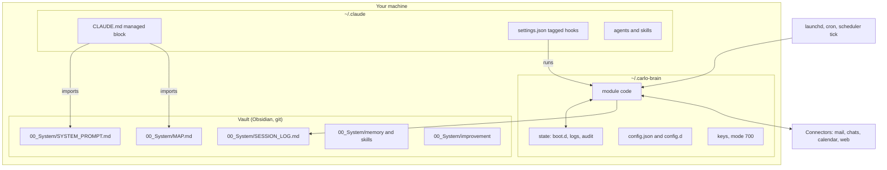
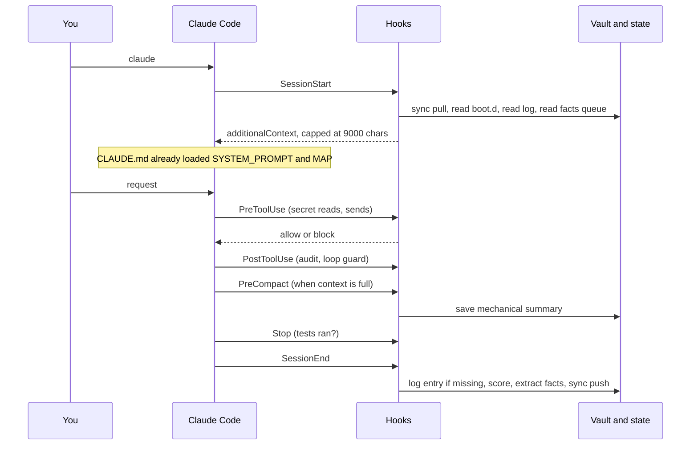
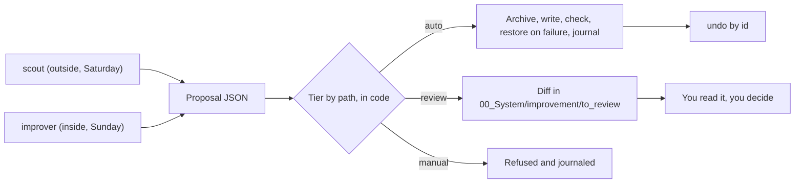

# 5. Architecture: how everything branches together

Carlo Brain is three things that never import each other's internals: a **vault** (memory in Markdown), a **hook layer** (Claude Code events calling small scripts), and **scheduled jobs** (work that happens between sessions). Modules plug into those three through a few conventions.

## The big picture



## Data flow of one session



What the model sees at the start of a session, in order:

1. `~/.claude/CLAUDE.md`, with `SYSTEM_PROMPT.md` and `MAP.md` imported in full. Stable, written by you, read by the model every time.
2. The boot injection from the `memory` hook: health problems, signals from other modules, facts waiting for validation, the last four session log entries (or the ones that match the project folder you started in). Dynamic, capped at 9,000 characters, never raises.

Everything else is read on demand: the project entry file named in MAP, a skill, the archive.

## Hook events

The hooks below are what the shipped modules register. `carlo status` shows the count per module.

| Event | Module | Script | What for |
|---|---|---|---|
| SessionStart (`startup\|clear\|compact`) | memory | `boot.py` | inject the boot context |
| SessionStart (`startup\|clear`) | sync | `sync.py start --detach` | commit then pull the vault, in the background |
| SessionStart | proactive | `run.py boot` | refresh a stale scan in the background, speak the briefing once a day if enabled |
| SessionStart | self-improve | `main.py boot` | catch up missed tasks, apply queued proposals, write a note about failures and reviews |
| SessionStart | night | `main.py boot` | show last night's report once |
| SessionStart | health | `healthcheck.py boot` | check scheduled jobs and connectors, run the safe repairs (once per failure per 24 hours), write or clear `health.md`, relaunch a stale job once |
| PreToolUse | security | `block_secret_reads.py`, `send_guard.py tool` | block secret reads and sends containing secrets |
| PostToolUse | security | `audit.py record`, `guardrails.py post` | audit chain of sends, loop reminder |
| UserPromptSubmit | security | `send_guard.py prompt`, `guardrails.py prompt` | the `send anyway` override, alignment reminder |
| Stop | security | `guardrails.py stop` | block the stop once if code changed and no test ran |
| PreCompact | memory | `precompact.py` | save last messages, changed files and decisions |
| SessionEnd | memory | `session_end.py` | auto log entry, quality score, fact extraction |
| SessionEnd | sync | `sync.py end --detach` | commit, push, ask the server copy to pull |

Hooks exit fast. Anything slow (fact extraction, sync, a refresh scan) runs in a detached process. Sessions that Carlo Brain starts itself (`claude -p` in jobs) carry `CARLO_HEADLESS=1`, and the session hooks do nothing in them.

Codex and Gemini have their own hook files; `carlo connect codex|gemini` (module `other-agents`) writes a SessionStart hook that runs the same `boot.py` and, for the pre-tool guards, a small adapter that renames the tool and its arguments to the shape the `security` scripts read. The hooks are tagged like the others and live in `~/.codex/hooks.json` and `~/.gemini/settings.json`, not in Claude Code's settings. See `modules/other-agents/README.md`.

## The boot.d convention

`~/.carlo-brain/state/boot.d/` is the one place where modules talk to the next session without knowing each other. Any script writes a Markdown file there:

```bash
printf '%s\n' '<!-- once -->' 'The nightly report is ready: 00_System/REPORT.md' > ~/.carlo-brain/state/boot.d/report.md
```

At the next `SessionStart` the memory injector reads every `*.md`, titles each section `Signal: <file name>`, cuts each at 1,500 characters, and deletes files whose first line is `<!-- once -->`. Without that marker the signal stays until something removes it (a conflict notice stays until you fix the conflict).

Who writes there today:

| File | Writer | Says |
|---|---|---|
| `proactive.md` | proactive | the ranked briefing and the rule for presenting it |
| `self-improve.md` | self-improve | failed tasks, proposals waiting for review, unread reports |
| `night.md` | night | last night's report, once |
| `health.md` | health | only when broken: a job late or a connector down, one line each, plus the one-line command for what only you can fix |
| a conflict file | sync | a pull conflicted, nothing was lost, fix it in the vault |

If you remove a module, its signal files stop appearing. If the injector is not installed (`memory` removed), signals are simply not shown, which is why `sync` declares `requires = ["memory"]`.

## File layout on disk

```text
~/.claude/
  CLAUDE.md                          your content + managed block (<!-- carlo-brain:begin/end -->)
  settings.json                      your settings + hooks tagged "# carlo-brain:<module>"
  settings.json.bak-carlo-<time>     backup taken before every change
  agents/ skills/                    from agents-skills, never overwriting yours

~/.carlo-brain/
  config.json                        vault path, names, installed modules, your `carlo config` values
  config.d/                          per-module config: proactive.json, self-improve*.json, night.json, telegram.json
  lib/                               shared helpers copied from core/lib
  keys/                              mode 700; key files mode 600, read through *_FILE variables
  <module>/                          module code, replaced on `carlo add`
  data/                              data you own: night/queue, night/done, whatsapp-mcp
  state/
    boot.d/                          signals for the next session
    runs/<name>.txt                  last run time of each hook (what `carlo doctor` shows)
    logs/                            module and launchd logs
    compactions/                     summaries saved before compaction
    errors.log                       one line per swallowed hook error
    audit.jsonl                      hash-chained record of sends
    quality.jsonl                    session quality scores
    proactive/ night/ self-improve/  per-module state, journals, archives, bench results
    agents-skills/manifest.json      hashes of the files the installer put in ~/.claude

<your vault>/
  00_System/
    SYSTEM_PROMPT.md  MAP.md  SESSION_LOG.md  CORRECTIONS.md
    FACTS_TO_VALIDATE.md             created by fact extraction
    memory/MEMORY.md + files         behaviour rules learned over time
    skills/*.md                      recipes the system prompt points to
    STYLE.md                         if you use the writer skill
    improvement/reports/ to_review/ CHANGELOG.md   from self-improve
  10_Projects/  20_Knowledge/  90_Archive/
```

Code folders are disposable (replaced on upgrade). Config, state, data, keys and the vault are yours and survive upgrades and `carlo remove`.

## Install and removal

`carlo add <module>`:

1. Resolves `requires` (dependencies first) and checks `deps` and `platforms`.
2. Parses `settings.json` first, so a broken file aborts before anything changes.
3. Copies `src/` to `~/.carlo-brain/<module>/`.
4. Renders the hook commands (`{PY}`, `{CODE}`, `{BRAIN}`, `{HOME}`), tags each with `# carlo-brain:<module>`, merges them into `settings.json` after a timestamped backup.
5. Runs the module's `install.sh` (folders, starter config, never overwriting).
6. Writes and loads launchd jobs on macOS, or prints cron lines on Linux.
7. Records the module and version in `config.json`.

`carlo remove` reverses 6, 4, then runs `uninstall.sh` and deletes the code folder. Because every entry is tagged, removal touches only what Carlo Brain added, in any order, without disturbing hooks you wrote yourself.

## The three improvement tiers

The `self-improve` module changes your setup by itself, which is only acceptable if the limits are hard. Every file belongs to a tier by its path, in a table evaluated by code. The most restrictive tier in a proposal applies to the whole proposal.



| Tier | Typical paths | What happens |
|---|---|---|
| `auto` | vault `memory/` and `skills/`, `~/.claude/agents`, `~/.claude/skills`, JSON files in `config.d` | applied with backup and checks (syntax, front matter, links, neighbouring tests); restored byte for byte if any check fails; undoable |
| `review` | `SYSTEM_PROMPT.md`, `MAP.md`, `~/.claude/CLAUDE.md`, `settings.json`, anything that smells like sending (mail, whatsapp, slack, telegram, send) | nothing changes; a current line and proposed line diff waits for you |
| `manual` | keys, the `security` module, self-improve's own code and config, `~/.ssh`, anything with secret, token, password, `.env`, key, credential in its name | refused |
| unknown | everything else | treated as `review` |

The manual list is in code. Your config can add rules to `auto` and `review`, never lower the protected paths, because a proposal that can edit the rules can unlock itself. Symlinks are resolved before classifying. The bench cases that judge changes sit under `manual` too.

The same module also provides the scheduler with catch-up (a laptop that slept through Sunday 09:00 runs the job when it wakes, once), the bench (your rules as test cases, scored by regex checks and a different judge model), and the loud failure notes. Details: `modules/self-improve/README.md` and `DESIGN.md`.

## Who may read and write what

| Actor | Vault | Messages, mail, calendar | Keys |
|---|---|---|---|
| You in a session | read and write | read, write on your `go` | blocked from opening by `security`; used through `*_FILE` |
| Weekly jobs (scout, improver) | read only, output goes to a scratch folder that code validates and copies | every send, create and update tool denied | blocked |
| Night tasks | their own work folder | read only | blocked |
| Telegram bridge | read tools by default | none | the bot token, mode 600 |

Next: [day to day](06-day-to-day.md).
